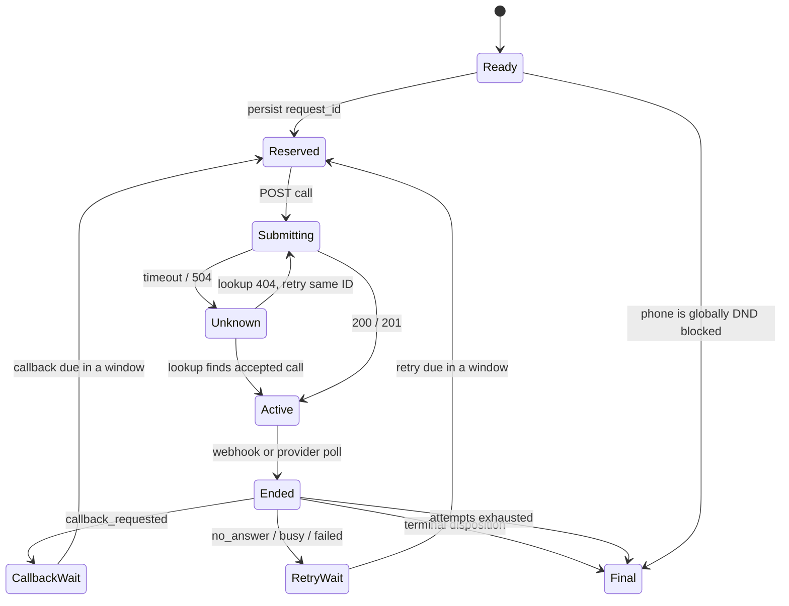

# Durable Campaign Dispatcher

## Candidate

- **Name:** Fill in before sharing.
- **Project scope:** Durable campaign dispatcher
- **Time spent:** Fill in honestly when the work is complete.

## How to run

Follow the setup and run commands in [README.md](./README.md). Run the scheduling tests with
`pytest` from the repository root.

## Design

The dispatcher is a single FastAPI process backed by SQLite. The `leads` table stores current
lead state; `calls` records durable intent and the provider result for each attempt. The
dispatcher commits a deterministic `request_id` before making the provider request. If the
process dies before or after acceptance, it looks up that same ID. A 404 means the provider has
not recorded it, so retrying that ID is safe; an existing call is adopted and polled until its
result is known. The provider idempotency key is the boundary across the network.

Phone numbers are Fernet-encrypted in SQLite. A keyed HMAC fingerprint supports phone-wide
uniqueness, active-call checks, and DND enforcement without storing searchable phone values.
The encryption key is supplied through `DISPATCHER_FERNET_KEY` and is not written into the
repository or database.

`request_id` is stable for one accepted-attempt slot (`campaign_id:lead_id:attempt_number`).
503 responses leave the accepted attempt count unchanged and wait before retrying. 504s and
network failures remain unresolved until the provider lookup settles the outcome. Webhooks are
verified against the raw-body HMAC and deduplicated by request ID; provider polling recovers a
lost webhook. Callback and retry times use `ended_at` and the provider's simulated clock. Calls
are reserved transactionally so tenant concurrency and phone uniqueness include requests whose
acceptance is still unknown.

## Decisions and assumptions

| Decision | Why | Alternative considered |
|---|---|---|
| SQLite for durable state | It is available locally and transactions protect the claim-before-request step. | Temporal or Postgres; either adds a service dependency for this single-process project. |
| One dispatcher process | Keeps deployment and local setup small while meeting the core scope. | Multiple workers require explicit ownership and shared callback deployment. |
| Use provider time for eligibility | Machine time may differ from the simulated carrier clock. | Trust local wall-clock time. |
| Keep a 60 simulated-second request margin at window close | Gives a slow local request time to reach the provider before a boundary. | Dispatch right up to closing and rely on provider skew tolerance. |
| Require an external Fernet key | Losing it should fail closed instead of silently making stored phone data unreadable or using a default secret. | Generate a key on every start (breaks crash recovery) or store it beside the database. |

## Failure modes considered

- **Crash before the provider request:** the persisted request ID is looked up; if absent, the
  same ID is sent.
- **Crash after provider acceptance but before local acknowledgement:** lookup by request ID
  adopts the accepted call without placing a second call.
- **504 or connection timeout:** retain the reservation and reconcile through the provider's
  request-ID endpoint.
- **503:** the provider says no call was placed, so no attempt is counted; retry later with the
  same key.
- **Duplicate or missing webhook:** duplicates are harmless; active calls are polled until the
  provider returns the ended result.
- **DND and shared phone numbers:** keyed phone fingerprints apply the block across all
  campaigns; completed and exhausted states take precedence.
- **Lost database or encryption key:** recovery is not possible; both are required persistent
  state and must be backed up together.

This version targets one dispatcher process. It does not implement multi-region failover or
two independent workers coordinating through a distributed lock.

## Testing

The focused unit tests cover inclusive/exclusive window boundaries, allowed days, the overlap
between campaign and regulatory windows, and callback/retry/fresh-lead ordering. Both a clean
run and a forced-stop recovery run were completed against the local provider.

## Results

Clean local provider run:

- Leads written: 200
- Calls placed: 407
- Provider violations: 0
- Difference against `/admin/leads`: 0 rows
- Maximum observed concurrency: `acme_insurance` 3 (limit 4), `zen_retail` 3 (limit 3)
- Callback lateness in simulated minutes: p50 1.9, p90 10.3, max 22.5
- Webhooks delivered: 407

Failure-injection and restart run (seed `2026`, failure scale `1`, speed `1200x`):

- The dispatcher was force-stopped after 92 calls and restarted with the same database and key.
- Calls placed: 422
- Provider violations: 0
- Difference against `/admin/leads`: 0 rows
- Webhook deliveries: 452, including 40 duplicate deliveries; 10 were lost and recovered by
  provider polling.
- Callback lateness in simulated minutes: p50 4.3, p90 36.4, max 52.2

The forced stop was performed on Windows, where it is equivalent to terminating the process;
the evaluator's `kill -9` scenario has not been run on Linux.

## If I had another day

1. Run multiple unseen provider seeds with injected failures and process restarts, and keep the
   reports as reproducible evidence.
2. Add focused persistence tests around webhook-before-response and 504 reconciliation.
3. Add multi-process coordination if horizontal scale becomes part of the requirements.
