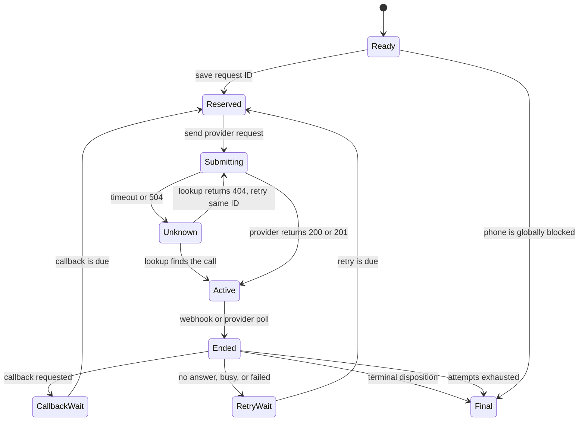

# Durable Campaign Dispatcher

## Project information

- **Project:** Durable campaign dispatcher
- **Name:** Fill in before sharing
- **Time spent:** Fill in honestly when the work is complete

## How to run it

The complete setup is in [README.md](./README.md). In short, start the provider in one terminal,
start the dispatcher in another, and run `pytest` from the repository root for the unit tests.

## The approach

I used one FastAPI process and a SQLite database. The database has one table for the current lead
state and another table for every call that has been reserved or sent.

The dispatcher creates a request ID before it talks to the provider. The ID is based on the campaign,
lead, and attempt number. If the process stops before sending the request, the same ID is sent after
restart. If the provider accepted the call but the process stopped before saving the response, the
dispatcher looks up that ID and continues with the existing call. This is how the service avoids
dialling the same attempt twice.

Phone numbers are encrypted before being stored. The service also stores a keyed fingerprint so it
can enforce one active call per phone and apply a DND decision across campaigns without using a
searchable plaintext phone number. The encryption key comes from `DISPATCHER_FERNET_KEY` and must be
kept between restarts.

## Lead lifecycle

A 503 means the provider did not place a call, so the attempt count stays the same. A 504 or a
network timeout is different: the call may have been placed, so the request stays unresolved until
the provider lookup tells us what happened. A webhook can arrive before the HTTP response; the
database logic accepts that result and will not overwrite an ended call later.

## Why I chose these pieces

| Choice | Why I used it |
|---|---|
| SQLite | It is easy to run locally, and transactions let me save a call reservation before network I/O. |
| One dispatcher process | It keeps ownership simple and is enough for the required local workflow. |
| Provider clock | The provider's simulated clock is the source of truth for windows and retry times. |
| 60-second closing margin | It gives a request some simulated time to reach the provider before a window closes. |
| External Fernet key | A missing key fails safely instead of silently creating unreadable data. |

## Failure cases handled

- A crash before the provider request reuses the saved request ID.
- A crash after provider acceptance adopts the existing call through a request-ID lookup.
- A 504 or network timeout remains reserved until its outcome is known.
- A 503 is retried later and does not count as an accepted attempt.
- Duplicate webhooks are ignored after the first event.
- Missing webhooks are recovered by polling the provider.
- DND is enforced across campaigns using the phone fingerprint.
- Completed and exhausted leads keep their required precedence over `dnd_blocked`.

The current version is deliberately single-process. It does not include multi-region failover or two
dispatcher workers sharing a distributed lock.

## What I tested

The unit tests cover the start-inclusive and end-exclusive window rules, allowed days, the overlap
between campaign and regulatory windows, and callback/retry/fresh-lead priority.

I also ran two provider checks. The first used failure injection disabled. The second used injected
failures and stopped the dispatcher after 92 calls before starting it again with the same database
and key.

### Clean run

- 200 leads completed
- 407 calls placed
- 0 provider violations
- 0 differences from `/admin/leads`
- Maximum concurrency: `acme_insurance` 3 of 4; `zen_retail` 3 of 3
- Callback lateness: p50 1.9, p90 10.3, maximum 22.5 simulated minutes
- 407 webhooks delivered

### Failure and restart run

This run used seed `2026`, failure scale `1`, and speed `1200x`.

- 422 calls placed
- 0 provider violations
- 0 differences from `/admin/leads`
- 452 webhook deliveries, including 40 duplicates
- 10 missing webhook deliveries recovered by provider polling
- Callback lateness: p50 4.3, p90 36.4, maximum 52.2 simulated minutes

The forced stop was done on Windows. The evaluator may use a literal Linux `kill -9`, which I did not
run locally.

## Improvements I would make next

1. Repeat the failure run with several unseen provider seeds.
2. Add persistence tests for webhook-before-response and 504 recovery.
3. Add multi-process coordination if the service needs to scale horizontally.
